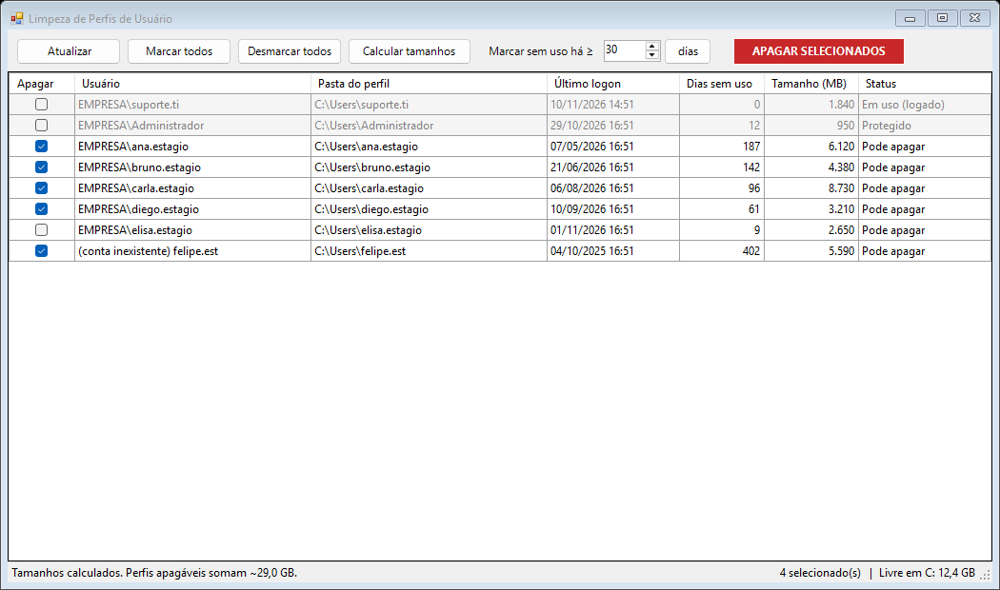

# LimpaPerfis

> **Limpeza de Perfis do Windows.** Apague vários perfis de usuário de uma vez, em uma única tela, em vez de excluir um por um no `sysdm.cpl`.




*Imagem com dados fictícios.*

## Motivação

**O problema.** Em setores com alta rotatividade, como estágio, laboratório, recepção e plantão, cada pessoa nova que faz login cria um perfil em `C:\Users`. Esses perfis ficam lá depois que a pessoa sai. Com o tempo, o SSD enche e o computador fica lento. A solução comum é abrir o `sysdm.cpl` e excluir perfil por perfil, ou formatar a máquina.

**A solução.** O LimpaPerfis mostra todos os perfis da máquina em uma janela só, com o último logon, os dias sem uso e o tamanho de cada um. O técnico marca os perfis que quer remover, ou seleciona automaticamente os que estão sem uso há N dias, e apaga todos com um clique. A exclusão usa o mesmo mecanismo do `sysdm.cpl`.

**Resultado:**

- Menos tempo de suporte: dezenas de perfis removidos em segundos, sem formatar a máquina.
- Mais espaço e desempenho: o espaço liberado é mostrado ao final.
- Segurança: o usuário logado, o técnico e as contas protegidas não podem ser apagados.
- Rastreabilidade: cada execução gera um log com o que foi apagado ou falhou.

---

## O que ela faz

- Lista todos os perfis locais da máquina, os mesmos que aparecem no `sysdm.cpl`.
- Mostra **usuário, pasta, último logon, dias sem uso, tamanho e status** de cada perfil.
- Permite **marcar vários perfis** e apagar todos com um clique.
- **Marcar sem uso há ≥ N dias:** seleciona de uma vez os perfis que não são usados há um certo tempo.
- **Calcular tamanhos:** mostra quanto espaço cada perfil ocupa e o total que pode ser liberado.
- No final, informa **quantos GB foram liberados**.
- Registra tudo em log: `C:\ProgramData\LimpezaPerfis\limpeza.log`.

A exclusão usa a classe `Win32_UserProfile` (`Remove-CimInstance`), que é o **mesmo mecanismo do botão "Excluir" do `sysdm.cpl`**. Ela remove a pasta do perfil e a entrada no registro (`ProfileList`), sem deixar perfis "quebrados" ou temporários.

## Proteções

Os perfis abaixo aparecem **em cinza e não podem ser marcados**:

| Situação | Motivo |
|---|---|
| Usuário logado no momento | O Windows não permite apagar um perfil em uso |
| Você (quem está rodando a ferramenta) | Evita apagar o próprio perfil |
| Perfis da lista `$PerfisProtegidos` | Contas de TI, administrador e funcionários fixos |
| Perfis de sistema | Ficam ocultos (SYSTEM, LocalService, NetworkService) |

Além disso:
- Antes de apagar, a ferramenta pede **confirmação** com a lista de nomes.
- No momento de apagar cada perfil, ela verifica de novo se o usuário não fez login nesse meio-tempo.

## Requisitos

- Windows 10 ou Windows 11. Também funciona no Windows Server 2016 ou mais novo.
- Windows PowerShell 5.1, que já vem instalado no Windows.
- Permissão de **administrador** na máquina.

## Como usar

1. Baixe o **[LimpezaPerfis.zip](https://github.com/eduardoGuerra56/limpeza-usuarios/raw/main/LimpezaPerfis.zip)** e extraia numa pasta.
2. Abra o `LimpezaPerfis.ps1` no Bloco de Notas e ajuste a lista de perfis protegidos. Veja a seção [Configuração](#configuração).
3. Dê **duplo clique no `LimpezaPerfis.bat`** e aceite o pedido de administrador.
4. Marque os perfis, ou use o botão "Marcar sem uso há ≥ N dias".
5. Clique em **APAGAR SELECIONADOS** e confirme.

> Se o Windows bloquear o arquivo por ter vindo da internet, clique com o botão direito no `.ps1`, vá em **Propriedades** e marque **Desbloquear**.

## Configuração

No topo do `LimpezaPerfis.ps1`:

```powershell
$PerfisProtegidos = @(
    'Administrador',
    'Administrator',
    'Default',
    'Public'
    # adicione aqui as contas que NUNCA podem ser apagadas, ex.:
    # 'suporte.ti',
    # 'joao.silva'
)
```

Use o **nome da pasta** em `C:\Users`, sem o domínio. A comparação não diferencia maiúsculas de minúsculas.

## ⚠️ Avisos importantes

- **Apagar um perfil é definitivo.** A Área de Trabalho, os Documentos, os Downloads e as configurações do usuário são perdidos. Antes de usar, confirme que os arquivos importantes ficam salvos na rede, no OneDrive ou num backup.
- A ferramenta **não apaga a conta do usuário** no Active Directory nem a conta local. Se a pessoa fizer login de novo, o Windows cria um perfil novo e vazio.
- Ela age **só na máquina onde é aberta**. Para muitas máquinas, veja a alternativa abaixo.
- Em ambientes com **AppLocker, WDAC ou antivírus restritivo**, scripts `.ps1` sem assinatura podem ser bloqueados. Nesse caso, peça para a TI liberar ou assinar o script.
- Faça o primeiro teste numa máquina com um perfil que você pode perder.

## Alternativa automática (domínio)

Se as máquinas estão no domínio, existe uma política de grupo nativa que apaga perfis antigos automaticamente na reinicialização:

> **Configuração do Computador → Modelos Administrativos → Sistema → Perfis de Usuário →**
> *Excluir perfis de usuário mais antigos que um número especificado de dias na reinicialização do sistema*

Esta ferramenta é útil quando você não tem acesso à GPO ou quando quer **escolher manualmente** quem apagar.

## Licença

[MIT](LICENSE). Pode usar, modificar e distribuir à vontade. A ferramenta é fornecida **sem garantia**: use por sua conta e risco.
